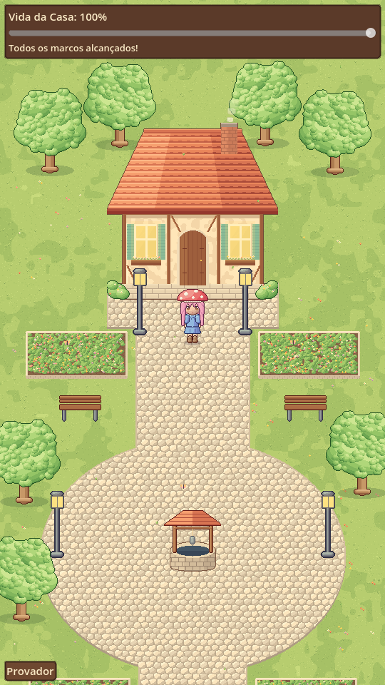

# Projeto sem nome

RPG mobile em pixel art (16-bit+) sobre saúde mental. As quests são passos pequenos e reais — beber água, abrir a janela, tomar banho, mandar mensagem para alguém — que ajudam a quebrar a rotina que mantém os sintomas da depressão. O jogo é 100% gratuito; a única monetização é cosmética.

> Nome provisório. Todos os nomes de sistemas e moedas neste repositório também são provisórios.

## Protótipo

O protótipo jogável da Fase 0 está em [`jogo/`](jogo/README.md) (Godot 4.4).

## Documento de design (GDD)

| # | Documento | Conteúdo |
|---|-----------|----------|
| 00 | [Visão geral](docs/gdd/00-visao-geral.md) | Proposta, pilares, público, o que o jogo **não** é |
| 01 | [Loop principal](docs/gdd/01-loop-principal.md) | Check-in, quests, recompensa, mundo que ganha cor |
| 02 | [Quests](docs/gdd/02-quests.md) | Banco inicial de quests por nível de energia e por região |
| 03 | [Economia](docs/gdd/03-economia.md) | Moeda, ganhos diários, preços, simulações |
| 04 | [Loja e monetização](docs/gdd/04-loja-e-monetizacao.md) | Regras éticas, catálogo, compra com dinheiro real |
| 05 | [Direção de arte](docs/gdd/05-direcao-de-arte.md) | Estilo, resoluções, sprites em camadas, paleta |
| 06 | [Segurança, ética e legal](docs/gdd/06-seguranca-etica-legal.md) | Recursos de crise, tom de voz, LGPD |
| 07 | [Técnico](docs/gdd/07-tecnico.md) | Godot, arquitetura, salvamento, notificações |
| 08 | [Roadmap](docs/gdd/08-roadmap.md) | Fases, MVP, playtest, perguntas em aberto |
| 09 | [A Praça](docs/gdd/09-praca.md) | Espaço compartilhado e seguro (depois do lançamento) |

## Arte

- [Briefing para artista](docs/arte/briefing-artista.md): estilo, especificações técnicas e lista de entregas para pedir orçamento.
- [Gerar arte com IA](docs/arte/gerar-com-ia.md): prompts prontos para o Gemini e script para trazer as imagens para o jogo.
