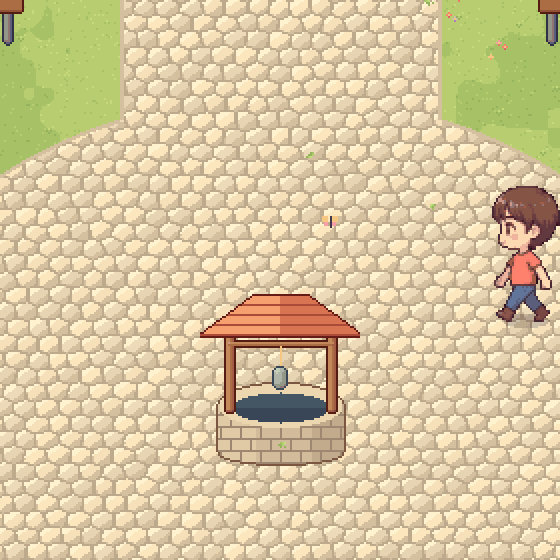

# Gerar arte com IA (gratuito)

Fluxo para gerar sprites com o Gemini (ou outra IA de imagem) e trazer para o jogo.

> Arte só de IA tem proteção autoral fraca e costuma precisar de retoque. Use para prototipar e como base; para o lançamento, um artista deve dar o acabamento (ver [briefing](briefing-artista.md)).

## 1. Prompt principal: personagem de frente, lado e costas

```
You are the lead pixel artist of a cozy mobile RPG about mental health and self-care. Create a CHARACTER TURNAROUND SPRITE SHEET.

STYLE (follow strictly):
- Classic 2000s Korean MMORPG chibi sprite style: big head (about 1/3 of total height), small slim body, about 2.5 heads tall, large expressive eyes with a white highlight, tiny mouth, soft pink blush on the cheeks.
- TRUE pixel art: hard square pixels, every pixel clearly visible, as if a 64x80 pixel sprite was upscaled 8x with nearest-neighbor. No anti-aliasing, no blur, no gradients, no painterly brush strokes, no noise, no dithering.
- Soft pastel palette, low contrast, calm and gentle. Maximum 8 shades per material.
- Thin 1-pixel colored outlines (dark brown, dark wine or dark navy) — never pure black.
- Soft shading with light from the top-left; shadows lean slightly purple, highlights lean slightly warm yellow.
- Mood: cozy, warm, kind, hopeful. Nothing dark, edgy or aggressive.

CHARACTER:
- A young adult with short, slightly messy brown hair with bangs, light peach skin, a friendly neutral expression.
- Simple everyday clothes: plain coral t-shirt, blue pants, small brown boots. No accessories.

LAYOUT:
- One horizontal row with 3 views of the SAME character: (1) facing the viewer, (2) facing away (back view), (3) facing right (side profile).
- Identical size and proportions in all 3 views, feet aligned on the same baseline, equal spacing, nothing cropped.
- Neutral standing pose, arms relaxed at the sides, feet slightly apart.
- A small soft oval shadow under the feet.
- Flat solid pure white background (#FFFFFF). No floor, no scenery, no text, no labels, no watermark, no frame, no grid lines.

DO NOT copy any existing game character, mascot or logo. DO NOT use a smooth HD illustration style. DO NOT add other characters.
```

## 2. Próximos pedidos: sempre com a imagem de referência anexada

O Gemini nem sempre usa a imagem anterior da conversa como referência. **Anexe a imagem do personagem** (botão +) e descreva o personagem de novo em todo pedido.

**Andando:**
```
The attached image is the official reference sheet of my character. Create a 4-frame WALK CYCLE of THIS EXACT SAME CHARACTER facing right, based on the side view of the reference.

Keep IDENTICAL to the reference: short, slightly messy brown hair with bangs; light peach skin, big eyes with white highlight, pink blush; plain coral t-shirt, blue pants, small brown boots; same chibi proportions and size; same pixel size, pastel palette, colored outlines and soft shading.

DO NOT add or change anything: no cap, no hat, no backpack, no jacket, no new clothes, no new colors, no different character.

Layout: one horizontal row, 4 frames, equal spacing, feet on the same baseline, plain pure white background, no text.
Frame 1: right leg forward, left arm forward. Frame 2: legs passing, body 1 pixel higher. Frame 3: left leg forward, right arm forward. Frame 4: legs passing, body 1 pixel higher.
```

**Se mudar o personagem:**
```
Wrong character. Look at the attached reference again and redraw it with EXACTLY that character: brown messy hair, coral t-shirt, blue pants, brown boots. Nothing on the head, nothing on the back.
```

**Se sair liso demais:**
```
Too smooth. Make it real low-resolution pixel art with big square pixels, no anti-aliasing, no gradients.
```

**Acessórios de cabeça:**
```
Same character and style (see attached reference), front view only. Create a grid of 10 versions of the character, 5 per row, each wearing a different cozy head accessory with a strong, instantly recognizable silhouette and colors slightly more saturated than the clothes: 1) knitted beanie with pompom, 2) red mushroom cap with white dots, 3) small green sprout with two leaves, 4) tiny happy floating cloud above the head, 5) flower crown, 6) teddy bear hood with round ears, 7) straw hat, 8) big soft headphones, 9) large ribbon bow, 10) cat-ear knit hat. All original designs. Plain white background, no text.
```

**Cenário:**
```
Same pixel art style. A vertical 9:16 game scene seen from a 3/4 top-down camera, like a classic 2000s MMORPG town: a small cozy half-timbered cottage with a terracotta tile roof, cream walls, wooden arched door and windows with flower boxes. In front, a light beige cobblestone path leading down to a small round plaza with a stone well. Pastel grass, raised stone flower beds, round fluffy trees, iron street lamps, wooden benches. Warm late-afternoon light, peaceful and empty (no people). Soft pastel colors, colored outlines, no text, no UI.
```

**Arte de divulgação (ilustração, não pixel art):**
```
A warm, cinematic anime-style illustration for a mobile game key art, vertical 9:16: a small cozy village coming back to color — the left side slightly desaturated and blue-gray, the right side full of golden late-afternoon light, flowers blooming, butterflies, leaves floating. A chibi young adult in a coral t-shirt and a red mushroom hat stands in the center, smiling gently. Hopeful, soft, healing mood. No text, no logo.
```

## 3. Trazer para o jogo

Funciona com a imagem baixada ou com um **print de tela** (o print fica um pouco menos nítido).

```bash
# 1. Converter cada imagem (use --quadros quando as figuras estiverem encostadas)
python3 ferramentas/importar_sprite.py parado.png parado_64.png --quadros 3 --previa previa.png
python3 ferramentas/importar_sprite.py andando.png andando_64.png --quadros 4

# 2. Montar a folha do jogo (6 x 3) e colocar em jogo/arte/personagem/ia/
python3 ferramentas/montar_personagem_ia.py parado_64.png andando_64.png jogo/arte/personagem/ia/gemini.png --ordem frente,lado,costas
```

O primeiro script remove o fundo e a sombra, separa os personagens, reduz para a escala real (quadros de 64 × 80, personagem com ~68 px de altura), limpa as cores e alinha os pés. O segundo monta a folha no formato do jogo; no protótipo, escolha **Visual → Gemini (teste)** no provador. Retoques finais podem ser feitos no Pixelorama (gratuito).



As imagens originais do primeiro teste estão em [`ia/`](ia/).

> Ainda falta separar o personagem em camadas (corpo, roupa, cabelo) para os cosméticos funcionarem. Esse passo é manual ou fica com o artista.

## Se o download do Gemini der erro

- No computador: clique com o botão direito na imagem → **Salvar imagem como** (ou **Copiar imagem** e colar num editor).
- No celular: segure o dedo na imagem → **Salvar** / **Baixar**.
- Tente outro navegador ou uma janela anônima (extensões às vezes bloqueiam o download).
- Em último caso, um print também serve.
