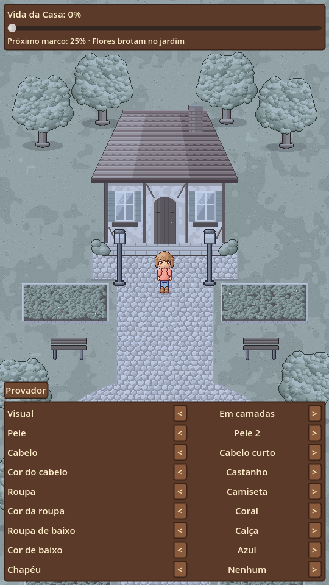
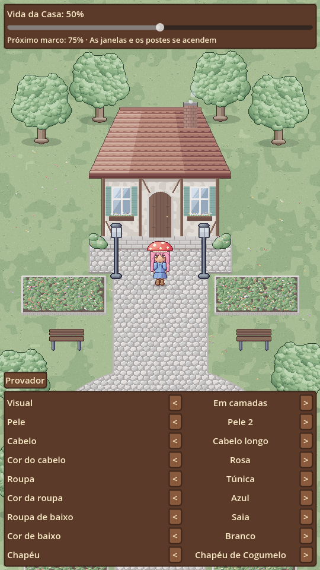
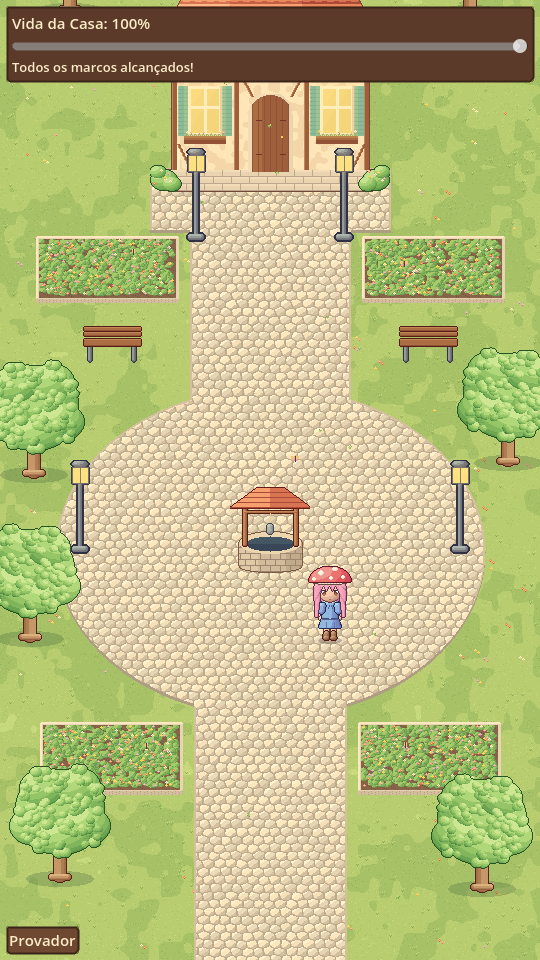
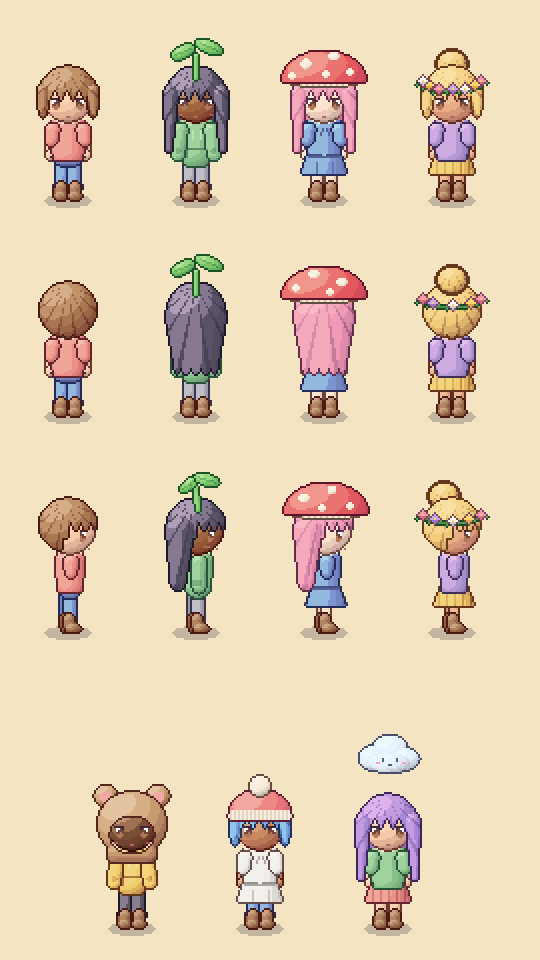

# Jogo — protótipo da Fase 0

Projeto Godot 4.4 para testar as bases técnicas descritas no [GDD](../docs/gdd/), já nas medidas e formatos da [direção de arte](../docs/gdd/05-direcao-de-arte.md) (Ragnarok em tons pastel). **Toda a arte é provisória**: é gerada por código para validar formatos e deve ser substituída por arte desenhada à mão, seguindo o [briefing para artista](../docs/arte/briefing-artista.md).

| Vida 0% | Vida 50% | Vida 100% | Perto do poço |
|---|---|---|---|
|  |  |  |  |



## O que o protótipo tem

- **Personagem chibi em 9 camadas**, quadro de 64 × 80, animação parado/andar nas 3 direções; o lado esquerdo é o direito espelhado.
- **Âncora de cabeça:** cabelos, rosto e chapéus (quadro de 96 × 112) têm só 3 desenhos e seguem a posição da cabeça em cada quadro do corpo.
- **Troca de paleta com rampas de 8 tons:** pele, cabelo e roupas são desenhados em cinza e coloridos por shader. 6 tons de pele, 10 cores de cabelo, 8 cores de roupa.
- **Cosméticos de teste:** 3 cabelos (curto, longo, coque), 3 roupas de cima, calça e saia, 6 acessórios de cabeça (broto, coroa de flores, gorro, nuvenzinha, chapéu de cogumelo, capuz de ursinho).
- **Chapéus que escondem o cabelo:** `esconde_cabelo = "topo"` usa o cabelo recortado; `"total"` esconde o cabelo inteiro.
- **Região Casa como cena ilustrada** de 540 × 1200 em 3/4, com chão de pedra no estilo de Prontera, canteiros, poço, postes e árvores. Objetos com ordenação por profundidade (o personagem passa atrás da casa e das árvores).
- **Toque para andar** com caminho (A*) calculado sobre uma **máscara de área caminhável**, suavizado em linha reta quando possível. Tocar num obstáculo leva ao ponto livre mais próximo.
- **Mundo desbotado** por shader, com 4 marcos: flores (25%), fumaça na chaminé (50%), janelas e postes acesos (75%), borboletas, folhas caindo e **luz dourada** (100%).
- **Personagem gerado por IA (teste):** no provador, **Visual → Gemini (teste)** troca as camadas por um personagem inteiro importado do Gemini (ver [gerar arte com IA](../docs/arte/gerar-com-ia.md)).
- **Painel de testes:** controle deslizante de vida da região e um provador para trocar aparência.

> O controle deslizante deixa a vida **descer** só para testes. No jogo, a vida de uma região nunca diminui (pilar "nunca punir").

## Como abrir

1. Instale o [Godot 4.4](https://godotengine.org/download) (versão padrão, não a .NET).
2. No gerenciador de projetos: **Importar** → selecione `jogo/project.godot`.
3. Aperte **F5** para rodar. No computador, o clique faz o papel do toque.

## Rodar no celular Android

1. No Godot: **Editor → Gerenciar modelos de exportação** → baixar.
2. Instale o Android SDK e configure em **Editor → Configurações do editor → Exportar → Android** ([guia oficial](https://docs.godotengine.org/pt-br/4.x/tutorials/export/exporting_for_android.html)).
3. **Projeto → Exportar → Adicionar → Android**. Em *Recursos*, inclua `*.json` em "Filtros para exportar arquivos que não são recursos".
4. Com o celular ligado por USB e a depuração USB ativada, use o botão de **implantação com um clique** (ícone do Android no canto superior direito).

## Estrutura

```
jogo/
├── arte/            # PNGs (gerados por ferramentas/gerar_arte.py)
├── cenas/
│   ├── personagem/  # Personagem em camadas
│   ├── vale/        # Região: cena, objetos, caminhos, marcos
│   ├── ui/          # Painel de testes do protótipo
│   └── principal.*  # Cena principal
├── data/            # Todo o conteúdo em JSON (paletas, itens, mapas, regiões)
├── shaders/         # troca_paleta e dessaturacao
├── sistemas/        # Autoload "Dados"
└── testes/          # Testes automáticos e capturas de tela
```

Conteúdo fica em `data/`, não no código. `catalogo.json` (itens e preços) é editado à mão; `paletas.json`, `ancoras.json` e `regioes/casa.json` são gerados pelo script de arte junto com as imagens.

## Testes

```bash
# Testes automáticos (sem janela)
godot --headless --path jogo res://testes/teste_prototipo.tscn

# Capturas de tela em docs/prototipo/ (precisa de tela; em servidor use xvfb-run)
godot --path jogo res://testes/captura.tscn
```

## Arte provisória

```bash
pip install pillow
python3 ferramentas/gerar_arte.py
```

O script documenta os formatos que a arte definitiva precisa seguir (tamanho dos quadros, ordem das colunas e linhas, tons de cinza para troca de paleta). Ao trocar pela arte desenhada à mão, mantenha esses formatos e o jogo continua funcionando sem mudar código.

## Limitações conhecidas

- Fonte padrão do Godot (não é pixel art) — escolher uma fonte pixel legível com acentos.
- Arte gerada por código: proporções e tons servem de referência, não de resultado final. Itens e personagens definitivos precisam ser criações originais desenhadas à mão.
- Ainda não foi testado num celular de verdade.
